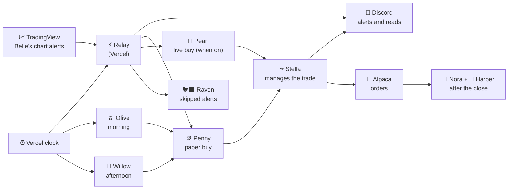

# 🔔 Belle Bots

A small team of trading bots for **SPX and SPY 0DTE options**. One bot reads the chart and calls the trade, one paper trades it, one manages every open trade, one trades live with tight rules, and a few more keep the records so the team learns every day.

> Educational project. Not financial advice. Options can lose 100% of what you pay. Paper results are not live results.

---

## 👯 Meet the team

| | Bot | What she does | When (ET) |
|---|---|---|---|
| 🔔 | **Belle** | Reads the chart and sends the alerts: the morning read, the afternoon read and every entry | all day |
| 🪙 | **Penny** | Paper trader. Buys the alert on a practice account | on each alert |
| ⭐ | **Stella** | Penny's manager. Babysits every open trade: the stop, the trims, the trail and the exit | until 15:59 |
| 🫒 | **Olive** | Watches the 30 minute opening range (ORH and ORL) on 15 minute candles | 10:00 to 12:15 |
| 🌿 | **Willow** | Watches for the afternoon stall break and its pullback entry | 14:00 to 15:55 |
| 🦪 | **Pearl** | Live trader. Same playbook as Penny with tighter rules. Off until switched on | W1 and EOD |
| 🐦‍⬛ | **Raven** | Shadow. Scores every alert Penny skipped, so we know which filters help | after the close |
| 📒 | **Nora** | Record keeper: daily recap, win and loss library, bot attendance | 16:00 |
| 📝 | **Harper** | Writes the daily review | 16:30 |

---

## 🗺️ How it fits together

---

## 📐 The rules in one place

Updated Nov 12, 2026. Times are ET (CT is one hour earlier).

| Window | ET | Belle alerts | Penny (paper) exit |
|---|---|---|---|
| ORB | 09:30 to 10:00 | Olive's opening range break | same as Window 1 |
| **1** | 10:00 to 12:30 | :40 to :55 of each hour, with the 1H/4H trend | **SPY:** -40% stop, sell 2 of 3 at +100%, the last one runs. **SPX:** -50% stop, no sale at +100%, then trails 30% below the best |
| 2 | 12:30 to 13:30 | Lunch, no trades | none |
| **3** | 13:30 to 15:00 | Any minute, no cooldown, no trend block | **-50% stop. Past +100% no sale, it sells on a 20% drop from the best.** Out 15:59 |
| **4 (EOD)** | 15:00 to 15:55 | Any minute, plus the 1m break of the afternoon high or low from 15:45 | same as Window 3 |

| Also | Rule |
|---|---|
| Contracts | 1 SPX + 3 SPY. SPY $0.19 to $0.60, SPX $70 to $250 ($50 to $170 from 13:30) |
| Never skipped | From 13:30, if nothing fits the price band Penny takes the closest contract (SPX up to $250, SPY up to $1.00) |
| Sage | Penny's backup on afternoon trades only (same exit). She leaves morning trades to Penny |
| Re-entry | Removed Nov 12 (lost in the 87 trade test: 2 wins in 18) |
| Stopped alert check | 15:05 ET: if Belle's EOD READ never arrived, Discord gets a warning |
| Pearl (live) | Off. Keeps her own tighter rules |

---

## 📊 Results

Every bot writes plain CSV files you can open in any spreadsheet:

| File | What is in it |
|---|---|
| `results/paper_trades.csv` | every Penny trade: entry, exit, best price, why |
| `results/or_breaks.csv` | Olive: size and volume of every opening range break |
| `results/shadow_scores.csv` | Raven: what the skipped alerts would have done |
| `results/pearl_trades.csv` | Pearl's live trades |
| `results/bot_health.csv` | Nora's check that every bot started on time |
| `results/*_library.csv` | the win and loss libraries the team learns from |

---

## ▶️ How to run it

1. **Copy the repo** and connect the `belle-cron` folder to a free Vercel project.
2. **Add your own keys as secrets.** Keys never go in the code:
   - GitHub, under Settings, then Secrets and variables, then Actions: `ALPACA_KEY_ID`, `ALPACA_SECRET_KEY`, `DISCORD_WEBHOOK_URL`
   - Vercel: the same Alpaca keys and webhook, plus `GITHUB_TOKEN`, `RELAY_KEY` and `CRON_SECRET`
   - Pearl only: `PEARL_KEY_ID`, `PEARL_SECRET_KEY`, `PEARL_WEBHOOK_URL`, and the variable `PEARL_ON` set to `true` when you are ready
3. **Point your TradingView alerts** at the relay link.
4. **Test first.** Every trading bot has a replay: open the Actions tab, pick the bot, press **Run workflow** and type a past date. Replays print to the log only: no orders, no Discord.

A code check runs on every change, so a broken file shows a red X before the market ever sees it.

---

Made with care for SPX 0DTE traders. Built on Alpaca, TradingView, Vercel, GitHub Actions and Discord.
